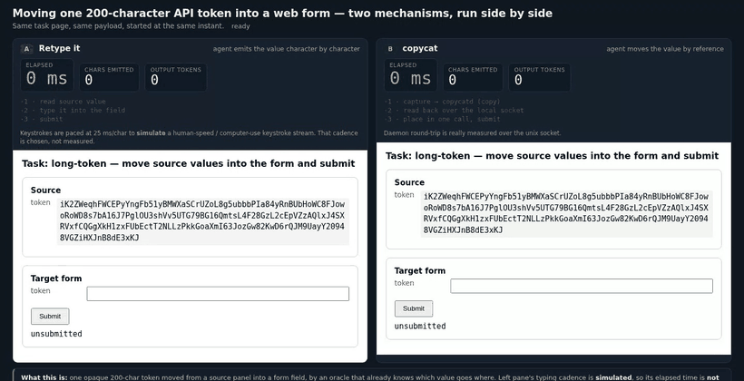

# <picture><source media="(prefers-color-scheme: dark)" srcset="docs/assets/mark-dark.svg"></picture> copycat

[](https://github.com/deanott/copycat/actions/workflows/ci.yml)
[](https://github.com/deanott/copycat/releases/latest)
[](#license)

> **A shared clipboard for AI agents.** One daemon owns the OS clipboard and keeps a
> timestamped ring of entries. Agents and you read and write the same clipboard over a
> local socket: one copies, the next retrieves. Recall costs ~50ns, a copy ~1µs, and nothing
> leaves the machine.



*The left pane retypes a 200-character API token, the right hands over a ~3-token reference. We
simulated the left pane's typing cadence, so read the token counters rather than the clock:
[the evals](evals/README.md) support the counters only.*

## Key ideas

- **Hand-off to you.** What the agent copies is on your real OS clipboard, so the last step is
  Ctrl/Cmd+V rather than a value read back out of a transcript. It works the other way too: copy
  something yourself and the agent reads that same entry, with `human:os` on it so it can tell.
- **Browser agents.** Filling in forms is boring, and watching an agent fill one is not much
  better. The speed-up is largest with a local model, where every token costs visible wall-clock.
  It shrinks as token generation gets faster, and it inverts on short values: break-even sat
  around 12 characters. The numbers and benchmarks are in [the evals](evals/README.md) and still
  under review.
- **A clipboard, not a memory.** Entries carry timestamps and you recall them by recency or time.
  Unlike a memory or embedding approach, the focus is quick access to the last few entries, not a
  long-term store: no round trips wasted on semantic embedding when you only want to yank
  something recent.
- **Hand-off between agents.** Named channels plus a blocking `wait`/`take` primitive
  (`copycat wait --channel L --take`, MCP `clipboard_wait`) let a downstream agent block on an
  upstream agent's value and consume it exactly once. `COPYCAT_SOCK` isolates a session.
  *This part matters less than it did. Agent runtimes now ship computer-use harnesses and their own
  storage and retrieval tools, and speculative decoding at the transformer level means the latest
  models need not manage short-term memory state themselves.*

## Try it

```sh
curl -fsSL https://raw.githubusercontent.com/deanott/copycat/main/dist/install.sh | sh
```

Full options, and building from source, in [Install](#install).


## Install

**Prebuilt binaries**: the one-liner in [Try it](#try-it). It takes the archive for your OS and arch
from the latest [release](https://github.com/deanott/copycat/releases/latest) and puts the binaries
on your `PATH`. [`dist/`](dist/README.md) has the overrides.

**From source.** Needs Rust ≥ 1.95 via rustup (`curl https://sh.rustup.rs -sSf | sh -s -- -y`),
since distro-packaged cargo is usually too old. Put `~/.cargo/bin` first on your `PATH`:

```sh
cargo install --path crates/copycatd
cargo install --path crates/copycat-cli
cargo install --path crates/copycat-mcp
```

Then run `copycatd` and drive it with `copycat`. `copycat-mcp` is an MCP server over stdio, so any
coding harness that speaks MCP can register it and get the same clipboard.

The repo ships a project-scoped [`.mcp.json`](.mcp.json), so a harness that reads one finds the
server on opening this checkout. It launches `copycat-mcp` from your `PATH`; `COPYCAT_MCP_BIN`
points it at a build in this tree instead.

**Tray app**, a source build on Linux and macOS and part of the Windows archive:

```sh
cargo install --path crates/copycat-ui --features gui   # needs GTK3/GL dev libs
sh crates/copycat-ui/dist/install-desktop.sh            # icon + launcher entry, --autostart for login
```

[`crates/copycat-ui/dist/README.md`](crates/copycat-ui/dist/README.md) lists the GUI system
libraries. For the Windows shortcut and login autostart, see
[`dist/README.md`](dist/README.md#always-on-daemon).


## Speed

NOTE: Benchmark comparison in progress.
Recall is flat: reaching back 128 entries costs what reading the current one costs, ~50ns, and a
copy ~1µs. Reproduce the numbers with `cargo bench -p copycat-core --bench store_hot_path`; the
agent-level measurements are in [`evals/README.md`](evals/README.md).

## Privacy

The clipboard's contents flow to whatever model sits behind your MCP client, so be deliberate about
what you copy while it runs.

[SECURITY.md](SECURITY.md) has the threat model.

## Configuration (environment)

Environment variables configure everything. The daemon reads `COPYCAT_PRIVACY` at boot and applies
it to every surface at once.

| Variable | Purpose | Default |
|---|---|---|
| `COPYCAT_PRIVACY` | Privacy posture: `off` \| `guarded` \| `strict`. See [Privacy](#privacy). | `guarded` |
| `COPYCAT_SOCK` | Socket path. Set it to run isolated daemons (per-session hand-off, tests). | `$XDG_RUNTIME_DIR/copycat/copycatd.sock` |
| `COPYCAT_CAPACITY` | Hot-store size: entries kept before eviction. | `256` |

The rest live with the code that reads them: `copycatd --help` lists the daemon's (device label,
log filter), and `COPYCAT_SESSION`, `COPYCAT_OSC52` and `COPYCAT_ALLOW_INSECURE_SOCKET` are
documented in `copycat-mcp`, `copycat-cli` and `copycat-core::ipc` respectively.

`COPYCAT_PRIVACY` sets a starting posture, not a lock: the tray changes it live and a restart
returns to what the environment says. `copycat status` reports it.

**Running it.** Start the daemon once and leave it up. Every other surface is a thin client over
its socket. A `COPYCAT_SOCK` in a private directory gives you a throwaway instance that leaves your
real clipboard alone.

```sh
copycatd &                       # logs to stderr
copycat copy "hello"             # also lands on your real OS clipboard
copycat paste                    # -> hello
copycat status                   # version, backend, entry count, privacy posture
```

## Docs

- [docs/TESTING.md](docs/TESTING.md): install it and watch it work, step by step
- [SECURITY.md](SECURITY.md): reporting a vulnerability, and what is in scope
- [CLAUDE.md](CLAUDE.md): crate boundaries, shared-policy rules, project conventions

## License

Licensed under either of

- MIT license ([LICENSE-MIT](LICENSE-MIT) or <https://opensource.org/licenses/MIT>)
- Apache License, Version 2.0 ([LICENSE-APACHE](LICENSE-APACHE) or <https://www.apache.org/licenses/LICENSE-2.0>)

at your option, the conventional dual license for the Rust ecosystem. Unless you state otherwise,
any contribution you intentionally submit for inclusion in this work, as defined in the Apache-2.0
license, is dual licensed as above, with no additional terms.
